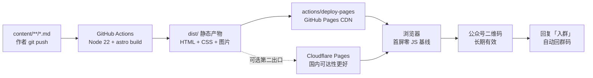

# 十优缠论 · 静态内容站 项目交付方案

> 版本：v1.1（终稿，2026-11-18 更新域名与商业化决策）  
> 编制：全栈架构交付专家团  
> 适用范围：首版上线（MVP），含二期演进路径  
> 文档约定：【目标值】= 架构承诺；【假设】= 需实测校准；【待确认】= 需业务方拍板

**已关闭的关键决策（v1.1）**

| 决策 | 结论 | 连锁影响 |
|---|---|---|
| 正式域名 | **`https://www.shiyouchanlun.com`**（根路径） | `base` 从 `/chan003/` 变 `/`；remark 前缀插件与子路径 404 风险整体消失；需 `CNAME` + DNS + HTTPS |
| 商业化 | **不做会员 / 付费 / 登录** | 纯静态架构成立，无需任何服务端；风险 R11 关闭 |

---

## 1. 项目定义与成功标准

### 1.1 一句话定义

**「十优缠论」是一个面向 A 股散户的缠论内容站：用成体系的知识建立专业信任，用每个交易日的复盘养成回访习惯，用公众号—微信群完成唯一转化。**

### 1.2 本站不是什么（同样重要）

| 不是 | 原因 |
|---|---|
| 不是流量生意 | 是信任生意。所有范围裁剪的第一约束是"不损伤专业信任" |
| 不是荐股平台 | 无证券投顾资质，全站不输出买卖指令、目标价、收益承诺 |
| 不是社区产品 | 不设注册、评论、UGC，讨论一律导向微信群 |
| 不是资讯搬运站 | 「消息解读」的价值在"一句缠论视角的解读"，不在新闻本身 |

### 1.3 成功标准

| 层级 | 指标 | 目标 | 性质 |
|---|---|---|---|
| 技术 | 移动端 LCP (p75, 4G) | ≤ 1.8s | 【目标值】 |
| 技术 | 文章页业务 JS | 0KB | 【目标值】 |
| 技术 | 站内资源 404 数 | 0 | 硬门禁 |
| 运营 | 复盘发布及时率 | 每交易日 18:00 前完成 push，≥95% | 【目标值】 |
| 业务 | 每周新增进群 | T+28 周 ≥30 人 | 【假设】 |
| 业务 | UV → 进群端到端转化 | ≥1.2% | 【假设】 |
| 业务 | 7 日回访率 | ≥15% | 【假设】 |

> 业务指标的口径缺口必须说清：微信群无开放 API，进群来源无法自动归因。缓解方式是不同位置用不同公众号回复关键词（`入群`/`复盘`/`资料`）分流 + 每周人工登记。这是"精度换成本"的取舍，首版接受。

---

## 2. 需求范围

### 2.1 栏目结构（3 个，已冻结）

| 枚举值 | 显示名 | URL | 更新频率 | 篇幅 | 站点作用 |
|---|---|---|---|---|---|
| `learn` | 缠论知识 | `/learn/<slug>/` | 每周 1–2 篇 | 1500–2500 字 + 3–6 图 | **拉新钩子**（SEO 长尾）+ 信任建立 |
| `review` | 收盘复盘 | `/review/<YYYY-MM-DD>/` | **每交易日 1 篇**（唯一日更） | 600–1200 字 + 1–3 图 | **留存核心** |
| `news` | 消息解读 | `/news/<YYYY-MM-DD>/` | 每周 2–3 篇 | 800–1500 字 | 差异化，给复盘提供基本面语境 |

**个股内容的落位**：不在独立栏目，而是 `review` 正文倒数第二节的固定小节「个股结构拆解」（级别判定 / 关键点位 / 失效条件），标题下强制渲染灰字免责提示。

> 决策依据见 §10「决策与权衡」第 1 条：内容不减少，但去掉"个股点评栏目"这个对外承诺式的栏目外壳，风险等级从"疑似荐股栏目"降为"复盘内的一个分析段落"。

### 2.2 页面清单（5 个模板）

| # | 页面 | 优先级 | 说明 |
|---|---|---|---|
| P1 | 首页 | Must | 深色头部 + 今日复盘主角 + 三栏目入口 + 社群入口 |
| P2 | 文章详情 | Must | 全站 90% 流量落点；含目录、免责声明、CTA、上下篇 |
| P3 | 栏目列表页 ×3 | Must | 同一模板复用 |
| P4 | 社群页 `/community/` | Must | 唯一转化落点；含群规、免责声明、公众号引导 |
| P5 | 归档 / 标签 | Should | 标签页仅在"该标签 ≥3 篇"时生成 |

### 2.3 明确不做（Out of Scope，写此以防反复）

站内搜索（内容 <80 篇前）、评论、用户系统、会员付费、实时行情、广告投放（首版 `ads.enabled=false`）、暗色模式切换、多语言、PWA、**实盘晒收益栏目**、**盘前必读**。

### 2.4 二期演进（触发条件驱动）

| 触发条件 | 动作 | 成本 |
|---|---|---|
| 文章 > 80 篇 | 接 Pagefind 静态搜索 | 1 人日 |
| 月 PV > 5 万 或 出现打开慢投诉 | 加 Cloudflare Pages 双出口 | 0.5 人日 |
| 决定做自然搜索流量 | 域名备案 + 国内静态托管 | 备案 2–4 周 + 1–2 人日 |
| 开始接广告 | `ads.enabled = true` + 填 slot provider | 0.5 人日 |

---

## 3. 系统架构

### 3.1 架构图



### 3.2 分层职责

| 层 | 位置 | 职责 | 约束 |
|---|---|---|---|
| 内容层 | `content/{learn,review,news}/**/*.md` | 唯一内容源 | 作者只碰这里 |
| 契约层 | `src/content.config.ts` | zod schema + 条件校验 | 字段写错在 CI 就红 |
| 领域层 | `src/lib/{posts,url,seo,validate}.ts` | 查询 / 前缀化 / SEO / 完整性校验 | 页面**禁止**直接 `getCollection()` |
| 视图层 | `src/layouts` + `src/components` | 3 个布局、组件 | 禁止为单页新建布局 |
| 路由层 | `src/pages/**` | 页面与 RSS | 禁止手写 URL 字符串 |
| 构建层 | `.github/workflows/deploy.yml` | 构建 + 原子发布 | — |

**依赖方向强制单向**：`pages → layouts → components → lib → content.config → content`。这条规则是防止 200 篇之后架构腐化的第一道闸。

### 3.3 技术选型

| 维度 | 纯手写 HTML | **Astro（采纳）** | VitePress | Hexo | Eleventy |
|---|---|---|---|---|---|
| Markdown 写作 | ✗ | ✓ content collections + zod | ✓ 最佳 | △ 约定繁琐 | △ 需自配 |
| 产物 JS | — | **0KB 基线** | 每页带 Vue 运行时 | 多数主题带 jQuery | 0KB |
| base path | 人肉相对路径 | 需自建 `withBase`（**域名在根路径后已无成本**） | **✓ 全自动** | 主题常硬编码 | ✓ 好用 |
| SEO | 手写 | **完全可控** | 主题决定，博客语义弱 | 插件齐 | 全靠自建 |
| 主题可定制 | 想怎么改怎么改 | **无主题，自己写组件** | 覆盖战争 | fork 别人主题 | 自己写 |
| 扩展性 | 全部手写 | 广告=组件+开关 | 要塞进扩展点 | 插件质量参差 | 全部自己拼 |
| **加权总分** | 2.75 | **4.53** | 3.63 | 3.28 | 3.65 |

**选 Astro 的 4 条硬理由**：① 文章页零 JS，对"微信内置浏览器 + 国内 4G"受众是决定性优势；② zod 强校验 frontmatter，日更时字段写错不会静默上线；③ 无主题意味着没有覆盖战争的沉没成本；④ `dist/` 与托管解耦，换托管只改 deploy 步骤。

**原方案唯一硬伤已随域名消失**：Astro 不自动前缀 base path，这在 `/chan003/` 子路径部署时是致命问题（要写 `withBase()` + remark 插件 + CI 前缀规则三重兜底）。**域名定在根路径后，`base='/'`，这个问题整体不存在**——只剩一个退化为直通的 `withBase()` 函数留作未来迁子路径的开关。

> 这是"域名要在架构定稿前定"的直接收益：它消掉的不是一条配置，而是一整套为免费托管妥协出来的复杂度。

### 3.4 内容模型（替代传统数据库设计）

本项目无数据库，**frontmatter schema 就是数据模型**。

| 字段 | 类型 | 必填 | 约束 |
|---|---|---|---|
| `title` | string | ✓ | ≤40 字 |
| `description` | string | ✓ | **80–120 字**，超长 warning，禁止 CSS 截断 |
| `pubDate` | ISO8601 | ✓ | **必须带 `+08:00`**，否则 CI 时区差异导致日期错一天 |
| `section` | enum | ✓ | `learn` \| `review` \| `news`，且须与目录一致 |
| `slug` | string | ✓ | `^[a-z0-9]+(-[a-z0-9]+)*$`，**按栏目内唯一**，发布后不可改 |
| `tags` | enum[] | ✓ | 2–5 个，**22 词受控词表**，硬校验 |
| `series` | enum | ✗ | 3 枚举；填了则 `seriesOrder` 必填 |
| `pinned` | boolean | ✗ | 全站同时 ≤2 篇 |
| `cover` / `coverAlt` | string | ✗ | 成对，缺任一则 fail；无 cover 时不渲染灰块 |
| `disclaimer` | boolean | ✗ | 默认 `section ∈ [review, news]` |
| `draft` | boolean | ✗ | true 时不出现在任何列表/RSS/sitemap |

**刻意不设的字段**：`featured`（与 pinned 重复）、`category`（与 section 重复）、`readingTime`（构建时算）、`prev/next`（自动推导）。**字段每多一个，日更错误率就上一个台阶。**

### 3.5 URL 契约（不可变）

**正式域名：`https://www.shiyouchanlun.com`**（2026-11-18 定）。站点在**域名根路径**，`base = '/'`，不再有 `/chan003/` 子路径。

```
https://www.shiyouchanlun.com/                       首页
https://www.shiyouchanlun.com/learn/<slug>/          缠论知识（不带日期）
https://www.shiyouchanlun.com/review/2026-11-17/     收盘复盘
https://www.shiyouchanlun.com/news/2026-11-17/       消息解读
https://www.shiyouchanlun.com/review/2026-11-17-02/  同日第二篇
https://www.shiyouchanlun.com/tags/<拼音>/           标签（≥3 篇才生成）
https://www.shiyouchanlun.com/community/             社群页（唯一放群活码处）
https://www.shiyouchanlun.com/rss.xml
https://www.shiyouchanlun.com/sitemap-index.xml
```

- **文件名 = frontmatter slug = URL 段**，三者完全一致，零转换逻辑
- 文件系统仍按 `content/review/2026/11/` 分目录（防单目录上千文件），但**不映射进 URL**
- slug 用英文/拼音 kebab-case：中文 URL 在微信内会被百分号编码，长链接更难读
- **URL 必须一次定死**：静态托管没有服务端 301，改规范意味着旧链接全 404
- **域名带来的净简化**：`base` 从 `/chan003/` 变为 `/`，原方案里为子路径做的三件套（remark 前缀插件、`check-links` 的 `/chan003/` 前缀规则、子路径 404 风险）**全部作废**。这是把域名放在上线前定掉的最大收益——子路径是一层纯粹为免费托管妥协出来的复杂度，域名一绑就消失了。
- **`github.io/chan003/` 永不再对外使用**。它会被 GitHub Pages 自动以 301 跳到自定义域名（这是 GitHub 唯一会自动帮你做的一次重定向），所以旧链接不会死。

---

## 4. 视觉设计系统

### 4.1 设计 token

| 组 | Token | 值 | 用途 |
|---|---|---|---|
| 墨色骨架 | `--ink-950` | `#0B141F` | 深色头部 / 页脚 / CTA 块 |
| | `--ink-900` | `#101C29` | 深色次层 |
| | `--ink-text` / `-2` / `-3` | `#E8EDF3` / `#B3C0CE` / `#8B9AA9` | 深底文字三级（对比度 7.6:1 / 4.9:1） |
| 浅色正文 | `--paper` | `#F5F4F1` | 页面底色（暖白，压住纯白刺眼感） |
| | `--surface` / `-2` | `#FFFFFF` / `#FAF9F7` | 卡片 / 内嵌块 |
| 文字 | `--text-1` / `-2` / `-3` | `#1A2028` / `#4C5764` / `#656F7B` | 正文 15.4:1 / 次要 7.4:1 / 辅助 4.5:1 |
| 品牌 | `--brand` | `#A82C2C` | 朱砂红：栏目标签 / CTA / 强调线 |
| 交互 | `--navy` | `#1D4E7C` | 正文链接 |
| **A 股语义** | `--up` / `--down` | `#C7382F` / `#1B7F58` | **涨红跌绿**（勿用欧美习惯） |
| 线 | `--line-1` / `-2` | `#E6E2DB` / `#D3CDC3` | 分割线 |

间距 8pt 栅格（`--s-1` 4px 至 `--s-10` 80px）；圆角 `6/10/14/pill`。

### 4.2 排版

| 层级 | 字号 | 说明 |
|---|---|---|
| H1 | 31px | 文章标题，行高 1.35，字重 700 |
| H2 | 20px | 小节标题，左侧 3px 品牌色竖线 |
| H3 | 17px | 段内小标题 |
| 正文 | 16px / 行高 1.8 | 行长 ≤42 个汉字 |
| 辅助 | 14px / 12.5px | 元信息、图注 |

字体：系统字体栈（`-apple-system, "PingFang SC", "Microsoft YaHei"`），**不引外链字体**。

### 4.3 组件清单

`SiteHeader`（深色 4 项导航，375px 不折叠）· `PostCard`（封面可选，无封面不留灰块）· `PostList` · `Pagination` · `TagCloud` · `SeriesNav` · `Toc` · `ChartFigure`（alt/width/height 必填）· `RiskNotice` · `CtaWechat` · `AdSlot`（首版渲染 null）· `JsonLd`

### 4.4 交互原则

- 一屏内最多一个视觉重量级 CTA；正文中段**不插任何 CTA**
- 禁止：弹窗、吸底条、倒计时、退出挽留、强制关注后阅读
- Lightbox 用 `<dialog>` + **`showModal()`**（原生提供焦点陷阱与背景 inert），全站一份约 2KB JS；`HTMLDialogElement` 不支持时降级为新窗口开原图

---

## 5. 实现要点

### 5.1 开工底座（8 项，顺序不可乱）

1. `astro.config.mjs`：`site: 'https://www.shiyouchanlun.com'`，**`base` 不设（即 `/`）**，`build.format: 'directory'`，`trailingSlash: 'always'`
2. `src/content.config.ts`：collection + zod schema + `superRefine` 目录/section 一致性
3. `src/lib/url.ts`：`withBase()` / `absUrl()` / `assetUrl()` —— **所有绝对 URL 唯一出口**（`base='/'` 时 `withBase` 退化为直通，但**函数保留**：它是将来迁 Cloudflare Pages 预览环境或任何子路径部署的唯一开关）
4. `src/lib/posts.ts`：`getAllPosts / getBySection / getByTag / getSeries / getAdjacent / getArchive`
5. `src/lib/validate.ts`：挂 `astro:build:start` 钩子，校验 slug 唯一、seriesOrder 连续、pinned ≤2
6. 三个 Layout：`BaseLayout` / `PostLayout` / `ListLayout`
7. remark 图片插件：自动 `width`/`height`/`lazy`，首图 `fetchpriority=high` 不 lazy，`` → `<figure>`
8. `check-links.mjs` 进 CI：站内链接存在性 + **`/chan003/` 残留检查**（防旧契约文本混入）

> **相对旧方案的减项**：原第 1、8 项里的"remark base path 前缀插件"和"未带 `/chan003/` 前缀即 fail"规则**随域名绑定一起删除**。少了约 30 行插件 + 一条 CI 规则，也少了一整类"作者手写绝对路径导致 404"的事故。原 8 项全部保留，只是其中两项变轻。

### 5.2 图片规范（两级，已冻结）

| 位置 | 宽度 | 目标体积 | 加载策略 |
|---|---|---|---|
| **首图** | ≤1200px | ≤100KB | 不懒加载 + `fetchpriority="high"`（它是 LCP 元素） |
| **正文图** | ≤1600px | ≤150KB | 全部 `loading="lazy"` |

- 300KB 是**红线不是目标**：超过就该怀疑这张图有问题
- 单篇 ≤8 张图，第 9 张 warning、13 张 fail；缺 `alt` fail
- 统一离线压缩为 WebP，`public/images/{covers,charts}/YYYY/MM/`
- 表格与结构图保留 WebP（不用 AVIF），牺牲 20–30% 体积换取离线兼容性

### 5.3 CTA 实现（静态站 + 活码过期的解法）

| 位置 | 内容 |
|---|---|
| 全站 CTA 组件（首页、文末） | **只放公众号二维码**（长期有效） |
| `/community/` | 群活码 1 处 + 「二维码更新于 YYYY-MM-DD」+ 失效兜底文案 |

**进群路径**：看到公众号二维码 → 关注 → 回复「入群」→ 后台自动回复最新群码。

**换群码不触发站点重建**——这是静态站与"活码 7 天过期"矛盾的唯一可靠解法。

三层兜底机制：群码图片单独可替换（`groupQr.ts`）→ 超 7 天构建期自动隐藏群码只留公众号路径 → 页面显示更新日期。

### 5.4 广告位预留（首版不渲染）

统一 `<AdSlot slot="..." />` 组件 + `src/data/site.ts` 的 `ads.enabled` 总开关。首版 `enabled:false` 时组件返回 `null`，但**CSS 里保留固定高度变量**——将来开启时 CLS 不会抖。插槽位置在布局层固化，开启广告只改一行配置。

**构建期按插槽决定每页最多 N 个**，运行时不检测（运行时检测要引入 `IntersectionObserver`，破坏 0KB JS 基线）。

---

## 6. 里程碑与排期

**人力假设【假设】**：1 名前端兼全栈 + 1 名内容作者（可同一人），每天可投入 3–4 小时。

| 里程碑 | 交付内容 | 依赖 | 估时 |
|---|---|---|---|
| M0 地基 | 开工底座 8 项 + 3 Layout | — | 2 人日 |
| M1 页面 | 首页 / 文章页 / 3 栏目列表 / 社群页 | M0 | 2 人日 |
| M2 发布链路 | Actions + Pages（Source 选 GitHub Actions）+ 首次上线 | M1 | 0.5 人日 |
| M3 内容入库 | 10–15 篇入门存量 + 复盘模板 | M1 | 内容侧 3–5 天 |
| M4 域名接入 | **`www.shiyouchanlun.com`** + `public/CNAME` + DNS + HTTPS + CF Web Analytics | M2 | 0.5 人日 + 域名费 |

**关键路径**：M0 → M1 → M2 → M4。M3 可与 M2 并行，但**上线时若无 10 篇以上入门内容，系列感不成立**，建议 M3 先于 M2 完成至少 8 篇。

---

## 7. 部署上线方案

### 7.1 CI/CD 链路

```yaml
on: push: branches: [main]
permissions: { contents: read, pages: write, id-token: write }
concurrency: { group: pages, cancel-in-progress: false }
jobs:
  build:  checkout → setup-node@22 (cache: npm) → npm ci
          → npm run check（astro check，frontmatter 写错在此红）
          → npm run build → upload-pages-artifact
  deploy: needs: build → deploy-pages（原子替换）
```

推送至生效【目标值】≤2 分钟；Pages CDN 缓存约 10 分钟。

### 7.2 上线前置检查（漏了会白折腾半天）

1. 仓库 `Settings → Pages → Source` 必须选 **GitHub Actions**（不是 Deploy from a branch）
2. 仓库 `Settings → Pages → Custom domain` 必须填 `www.shiyouchanlun.com`，且 **`public/CNAME` 必须进构建产物**——用 Actions 部署时若 artifact 里没有 CNAME，GitHub 可能把自定义域名清掉，表现为"站点突然回到 github.io 且没有报错"
3. 仓库必须 **Public**
4. `package-lock.json` 必须提交（CI 用 `npm ci`）
5. 构建后 grep 验证：`dist/sitemap-0.xml`、`dist/rss.xml` 里的地址全部以 `https://www.shiyouchanlun.com/` 开头，**不得出现 `github.io`**

### 7.3 域名接入（已定：`www.shiyouchanlun.com`）

**明确判断：`*.github.io` 不能作为对外入口。** 它走 Fastly，国内是"时好时坏、按运营商和时段随机"，而流量高峰正是收盘后 15:00–20:00，落地页打不开等于当天转化归零且不可挽回。域名已在架构定稿前定下，这一步的决策成本已经归零。

#### 接入顺序（顺序错了会白折腾半天）

1. **仓库根建 `CNAME` 文件**，内容一行：`www.shiyouchanlun.com`（无协议、无斜杠、结尾不要加点）
2. **DNS 配好但先不开代理**（Cloudflare 灰云 / DNS only）

| 主机记录 | 类型 | 值 | 说明 |
|---|---|---|---|
| `www` | CNAME | `shiyouchanlun.github.io` | 注意**没有** `/chan003`，GitHub Pages 自定义域名下项目站点服务在域名根 |
| `@`（apex） | A | `185.199.108.153` / `.109.153` / `.110.153` / `.111.153` | 四条全填；用 Cloudflare 时可用 CNAME 扁平化指到 `shiyouchanlun.github.io` |

3. **仓库 `Settings → Pages → Custom domain` 填 `www.shiyouchanlun.com` → Save**，等 DNS 校验通过
4. **等 GitHub 自动签发 Let's Encrypt 证书**（通常几分钟到 1 小时），证书就绪后勾选 **Enforce HTTPS**
5. **确认 HTTPS 正常后**，才考虑是否开 Cloudflare 橙云代理（见下方坑 ②）

#### 四个必踩的坑

**① 橙云代理会让证书签发失败。** GitHub 用 HTTP-01 校验域名归属，Cloudflare 代理会拦截这条路径。**必须先灰云拿到证书、勾上 Enforce HTTPS，再开代理。**

**② 开代理后 SSL/TLS 模式必须是 `Full`，不能是 `Flexible`。** GitHub Pages 强制 HTTPS，若 CF 用 Flexible（回源走 HTTP），会形成无限重定向 `ERR_TOO_MANY_REDIRECTS`。

**③ 不要指望 Cloudflare 免费版给国内加速。** CF 的中国大陆节点需要企业版（与京东云合作），**免费版国内用户走的是香港/洛杉矶/圣何塞节点**。实测口径下它对大陆访问"不加速、可能略慢"。所以它在本项目的真实价值是**控制权**——能改响应头、能做 301 规则、能给 apex 做跳转——**不是速度**。原方案里"CF 免费代理改善国内可达性"这句话是过度期待，此处更正。

**④ apex 跳 www 不要依赖 GitHub 自动行为。** 主选 www 为规范域名，apex 用 Cloudflare 的 Redirect Rule 做 301（免费版可用）。GitHub Pages 自身对 apex/www 的处理不保证，别赌。

#### 备案判断（现在不需要，但要提前知道）

- **解析到 GitHub Pages（境外）不需要 ICP 备案**，现在就可以上线
- 域名若在国内注册商（阿里云/腾讯云），只需完成**实名认证**，不备案也能解析到境外
- **将来要走 P2 国内托管（COS+CDN）就必须备案**，而这里有一个硬门槛：**证券/金融类内容以个人主体备案基本过不了**，多数省份要求企业主体，部分还涉及前置审批。所以"要不要办营业执照"不只是群码和广告的问题，它同时是**国内托管的前置条件**

### 7.4 国内可达性：分三阶段

| 阶段 | 方案 | 时机 | 状态 / 迁移成本 |
|---|---|---|---|
| **P0** | **自有域名 `www.shiyouchanlun.com`** + Cloudflare（可选，只取控制权） | 上线即做 | **已决策**；加 `public/CNAME` 一行，代码零改动 |
| P1 | 同一份 `dist` 双出口推 Cloudflare Pages | 月 PV > 5 万或出现打开慢投诉 | 加 15 行 YAML |
| P2 | 国内静态托管（腾讯云 COS+CDN / EdgeOne） | 决定做百度 SEO 或广告变现时 | 加一步 `rclone sync`；**需 ICP 备案 2–4 周 + 主体资质** |

迁移成本之所以低，是因为构建（`dist/`）与托管彻底解耦——**这也是选 Astro + Actions 而非 Hexo + 内置 Jekyll 的真正原因**。

### 7.4 运营约束（写死，勿破）

- 复盘每交易日 **18:00 前完成 push**；验收口径 = 18:00 前提交、**18:15 前读者可见**
- 实时性诉求交给公众号推文（15:30–18:00 发布），站点做沉淀
- **时效表述分工**（v2.1 定稿）：
  - **站内**：只承诺"每个交易日"，**不承诺具体推送时点**，不做群内推送预告、不写"预计 16:30 送达"
  - **公众号**：可以承诺固定推送时点（建议 16:30），因为它是唯一能控制的单一渠道
  - 两者不重复：公众号兑现的承诺，站点不再兑现一遍——这比放宽站点承诺更容易守住
  - 理由：16:30 是**工作日最早合理发布点**，不是阅读高峰（早高峰是 8:00–9:00 与 19:00–21:00）。它低于盘面变化速度就停，因为读者要的是当日结论；选它是为了留出冷静时间与写作余量，能守住比峰值更重要

---

## 8. 测试与验收清单

### 8.1 技术验收（上线门禁）

| 项 | 口径 | 目标 |
|---|---|---|
| LCP | 移动 4G p75 | ≤1.8s |
| CLS / INP | p75 | ≤0.05 / ≤200ms |
| Lighthouse | 移动端 | Perf ≥95、SEO ≥95、A11y ≥90 |
| 站内 404 | 全站资源与链接 | 0（硬门禁） |
| 站内死链 | 构建期校验 | 0 |
| 绝对 URL 域名单一性 | CI grep `dist/` | 不得出现 `github.io`；sitemap / rss / canonical / OG 全部为 `https://www.shiyouchanlun.com` |
| HTTPS | 线上 | 证书有效；`Enforce HTTPS` 已开；apex 301 到 www |
| 响应式 | 375 / 768 / 1280 | 无横向滚动；375px 导航不折叠 |
| 正文对比度 | — | ≥4.5:1 |
| 首屏无遮挡 | 首页 | CTA 不覆盖首屏内容 |
| 群码可替换性 | — | 换码 = 换 1 个文件，不改模板 |

### 8.2 业务验收（T+14 / T+28）

| 指标 | 口径 | 目标 |
|---|---|---|
| 北极星：周新增进群 | 自然周，人工登记 | T+28 周 ≥30 人【假设】 |
| 加群漏斗 | UV → 社群页 UV(≥8%) → 活码曝光(≥90%) → 扫码(≥15%) | 端到端 ≥1.2%【假设】 |
| 文末主 CTA 点击率 | 点击 / 页面 UV | ≥3%【假设】 |
| 公众号关注转化 | 新增关注 / 全站 UV | ≥4%【假设】 |
| 阅读完成率 | 滚至正文 80% | 入门 ≥35%、复盘 ≥50%【假设】 |
| 7 日回访率 | — | ≥15%【假设】 |
| 复盘发布及时率 | 18:00 前 push / 交易日 | ≥95% |

### 8.3 埋点最小集（6 个，不埋用户标识、不埋搜索词）

`page_view`（含栏目、文章 ID）· `scroll_80` · `cta_click`（位置 + 层级）· `qrcode_click` · `qrcode_expired_hint_click` · `outbound_wechat_click`

---

## 9. 风险清单

| # | 风险 | 概率 | 影响 | 应对 |
|---|---|---|---|---|
| R1 | **合规：无投顾资质做个股内容** | 中 | 高 | 已取消 `stock` 独立栏目，个股内容降为复盘内小节；`review`/`news` 强制免责声明；**全站禁用"买入/卖出/目标价/稳赚/带你赚/跟上操作"**；每月一次全文检索复核 |
| R2 | 失效行情下复盘质量下降 | 高 | 中 | 无结构日写"今天没有结构"的轻量版（300–500 字）；**写"今天没有结构"比硬凑一个结构更专业** |
| R3 | 国内访问不稳定 | 高 | 高 | **域名已定并作为 P0 落地**（`www.shiyouchanlun.com`）；P1 视投诉决定双出口；P2 备案 + 国内托管。**注意：CF 免费代理不加速国内，不要把它当解法** |
| R4 | 群活码 7 天过期致转化断裂 | 高 | 中 | 群码只放 `/community/`；超 7 天构建期自动隐藏；公众号兜底路径 |
| R5 | 容量（带宽 100GB / 体积 1GB） | 低 | 中 | 图片规范；按压红线算约 **1450 张/年**，3 年不撞上限。**跑通后再提迁移，不是等出事** |
| R6 | Pages CDN 缓存 10 分钟 | 高 | 低 | 时效表述分工（见 §7.4），不承诺时点即无违约风险 |
| R7 | 仓库 Public 被镜像/洗稿 | 高 | 中 | canonical 指向主站 + 正文内嵌来源文字水印 |
| R8 | 无服务端 301，改 URL 致旧链全断 | 中 | 高 | URL 契约一次定死；`404.astro` 内置旧路径映射 |
| R9 | frontmatter 写错致文章静默不上首页 | 中 | 中 | zod + 目录一致性校验 + CI 门禁 + `new-post.mjs` |
| R10 | 内容产能不可持续 | 高 | 高 | 固定复盘模板（单篇 20–30 分钟）；`news`/`learn` 降频；及时率作为内部指标 |
| R11 | ~~业务方后续要会员/付费~~ | **已关闭** | — | **2026-11-18 明确：不做会员/付费。** 纯静态架构成立，无需引入服务端。此决策同时锁死了三件事：不做登录、不做支付、不做"付费可见"内容——**任何一条回来，架构都要重估** |
| R12 | 百度收录慢 | 高 | 中 | 域名已解决"`github.io` 不被信任"的问题；剩余障碍是**托管在境外 + 未备案**，百度抓取优先级仍偏低。接受：流量靠微信生态。**要做百度 SEO 就必须走 P2 备案 + 国内托管** |
| R13 | 跟单型流量污染群生态 | 中 | 中 | 群规前置；不承诺收益；接受"进群少但精" |
| R14 | 单一引流源（短视频）断裂 | 中 | 中 | 首版就把 SEO 长尾（入门系列）作为第二条腿 |
| R15 | 若后期加 `stock` 栏目 | — | 高 | **必须资质前置**：无资质前不得开栏目，只能为复盘内小节 |
| R16 | **域名成为唯一入口，DNS/续费故障 = 全站不可达** | 低 | 高 | 绑域名带来的新风险。① 域名**开自动续费**并单独记到期日——忘续费是最常见的自毁方式；② DNS 改动前截图存档；③ `github.io/chan003/` 保留为**应急备用入口**（不对外宣传但确保可用）；④ Cloudflare 免费版无 SLA，做代理即多一个故障点 |

---

## 9.5 首页「结构案例」渲染规则（v2.1）

右栏不是栏目，是按标签聚合的专题。规则：

| 条件 | 渲染 |
|---|---|
| 该标签下 ≥3 篇 | 渲染 **3 条**（不多不少） |
| 不足 3 篇 | **整块不渲染**（不留空占位、不放"暂无内容"） |
| 任何情况 | **不出现「查看更多 / 共 N 篇 / 分页」** |

原因：它是首页的引导区块而非独立入口。能渲染 3 条说明这个专题已经立得住；凑不够 3 条还硬放，等于在首页展示一个不存在的栏目——**而"栏目建了但空着"比没有栏目更伤信任**。

---

## 9.6 路径书写约定

交付文档、代码注释、沟通里提到文件时，**一律省略 `src/`、`.github/workflows/`、`public/` 前缀**：

| 简写 | 实际 |
|---|---|
| `pages/index.astro` | `src/pages/index.astro` |
| `deploy.yml` | `.github/workflows/deploy.yml` |
| `robots.txt` | `public/robots.txt` |

正文完整路径只出现在 §3 目录结构一次。阅读速度优先于形式精确。

---

## 10. 决策与权衡

> 每条都写明被否决的方案与否决理由。这是本方案最值得复用的部分。

### 10.1 取消「个股分析」独立栏目

- **采纳**：个股内容并入复盘正文小节
- **否决**：保留独立 `stock` 栏目 + 强化免责声明
- **理由**：内容一点没少，但形态从"对外承诺式的个股点评栏目"变成"复盘里的一个分析段落"，监管口径下的风险等级完全不同。用户无投顾资质。代价是失去一个清晰的流量入口，用首页「结构案例」聚合位缓解。

### 10.2 URL 不带栏目前缀、不带年月层级

- **采纳**：`/review/2026-11-17/`（文件名 = slug = URL 段）
- **否决**：`/review/review-2026-11-17/`（产品侧编辑习惯）与 `/review/2026/11/2026-11-17/`（架构侧初版）
- **理由**：这个链接主要在微信群转发和公众号「阅读原文」流通，`review/review-` 的重复段看起来像未上线的测试页，直接伤点击信任；年月层级的冗余收益（归档）用列表页就能覆盖。静态站没有 301，定错的反悔成本远高于此刻多花 30 秒讨论。

### 10.3 全站 CTA 只用公众号二维码

- **采纳**：公众号二维码 + 回复关键词取群码
- **否决**：全站直接放微信群活码
- **理由**：微信活码 7 天/满 200 人失效，静态页放死码等于转化路径静默断裂且难被发现。代价是多一跳（关注→回复→拿码），转化率会降；换来的是路径永不中断，且换码不需要重建站点。

### 10.4 不做「关注才能看全文」的强门槛

- **否决**：强制留资后阅读
- **理由**：静态站的核心资产是 SEO 收录与可分享性；一上墙，搜索结果全是"请关注后阅读"，专业形象与长尾流量同时崩。代价是短期新增数字比行业玩法低 3–5 倍【假设】，接受——信任型转化 LTV 更高。

### 10.5 技术栈选 Astro

- **否决 VitePress**：它是文档站框架（侧边栏 + 目录层级），做"复盘卡片流 / 置顶 / 标签聚合"要绕开默认主题重写，成本比从零写更高；每页带 Vue 运行时并 hydrate，JS 预算守不住；主题定制是 shallow 覆盖。**它 base path 处理最好，但一个优点抵不过四条缺陷。**（若本项目只是纯教程文档、不含日更内容流，VitePress 会是首选）
- **否决 Hexo**：主题即 EJS/Pug，"改视觉"等于 fork 别人主题，长期维护成本最高；无类型化 frontmatter 校验；多数主题带 jQuery 类依赖。
- **否决 Eleventy**：技术上比 VitePress 更适合（构建最快、`pathPrefix` 好用），加权分也更高。**否决原因不是技术而是交付节奏**：列表/标签/分页/RSS/SEO 全部要自己从零拼，且没有 frontmatter 校验——日更时字段错误会静默产出错误页面。对 1–2 人团队，少写胶水代码比框架纯粹更重要。
- **否决纯手写 HTML**：多篇文章必然是复制粘贴改内容，1 个月后就是 90 个重复文件。

### 10.6 用 GitHub Actions 而非内置 Jekyll 构建

- **理由**：内置构建有插件白名单、装不了 Node 工具链（没有 Astro、没有内容校验）；有约 10 次/小时构建软限制且报错不透明；产物不可移植。Actions 产出标准 `dist/`，能原子部署，今天发 Pages、明天发 Cloudflare 只换 deploy 步骤。

### 10.7 图片改为"离线压缩 + 构建期只校验尺寸"

- **采纳**：一律离线压缩，构建期仅校验宽高与体积
- **否决**：构建期 `astro:assets` 转 WebP
- **理由**：构建时间不随图片数线性增长，SLO 能守在 90s；代价是牺牲约 20–30% 体积收益，用 CI 分钟的隐性成本换，值。

### 10.8 校验设计四原则（本轮讨论的产物）

1. **不制造可被低成本绕过的检查**——风险词黑名单能被"换个词、内容不动"消掉，是假检查，改为人工审稿 checklist。**禁用词表是给写稿的人看的，不是给机器看的。**（校验项的取消标准：若作者的规避动作不改变被检查对象，该检查应删除或降级为 review 提示）
2. **不提示不该做的动作**——图注 warning 只在 `review` 生效；对 `news` 的截图发 warning，等于每天提示作者做一件不该做的事。
3. **不在运行时做能放到构建期的事**——广告位"同屏数量"改为构建期按插槽决定，避免为检测引入 JS 破坏 0KB 基线。
4. **用低频人工表兜住被删的自动规则**——被取消的自动校验必须有对应的低频人工核查（如每月一次全文检索"买入/卖出/目标价/稳赚"）作为兜底。没有兜底的"取消校验"，等于下次上线时静默回退。

---

## 11. 待确认清单

| # | 项 | 影响 | 状态 / 默认值 |
|---|---|---|---|
| Q1 | ~~正式域名~~ | 决定 canonical/OG/RSS 全部绝对 URL、`base` 是否为子路径 | **已定（2026-11-18）：`https://www.shiyouchanlun.com`**，根路径部署，`base='/'` |
| Q2 | 统计工具选型（CF Analytics / 百度统计 / Umami） | 决定埋点能否落地、是否影响 LCP 与隐私合规 | CF Web Analytics（无 cookie） |
| Q3 | 主体资质与营业执照 | ① 能否用企微活码（省 52 次/年换码）② 广告变现前置 ③ **国内托管备案的前置**（金融类内容个人备案基本过不了） | 按无资质处理 |
| Q4 | 首版入门存量篇数 | 系列感是否成立 | ≥10 篇 |
| Q5 | 现有群规模与群管理人力 | 决定群规与入群审核的强度 | 按 1 人兼职管理 |
| Q6 | ~~未来 12 个月是否做会员/付费~~ | 决定纯静态架构是否成立 | **已关闭（2026-11-18）：不做。纯静态架构成立** |

---

## 12. 交付物清单

| 文件 | 说明 |
|---|---|
| `design/mockup-home.html` | 首页高保真效果图（自包含、零外链，可直接双击打开） |
| `design/mockup-article.html` | 文章详情页高保真效果图（含「个股结构拆解」小节与免责提示） |
| `docs/交付方案.md` | 本文件 |
| `CNAME` | **自定义域名绑定文件**（`www.shiyouchanlun.com`）。当前在仓库根，适配"分支部署"；迁 Astro 后必须移到 `public/CNAME`，否则 Actions 产物里没有它，域名会被 GitHub 清掉 |
| `index.html` / `README.md` | 过渡期示例页与部署手册（Astro 上线后被 `dist/` 取代） |

> 效果图是**设计稿**（`design/` 目录不进 Astro 构建，且带 `noindex`），不是上线页面。正式实现时按 §4 的 token 与 §5 的组件拆分落到 `src/layouts` 与 `src/components`。

---

*本方案的隐含第一约束：**这不是流量生意，是信任生意。** 所有功能取舍、技术选择、文案禁忌都能由此推导。*
